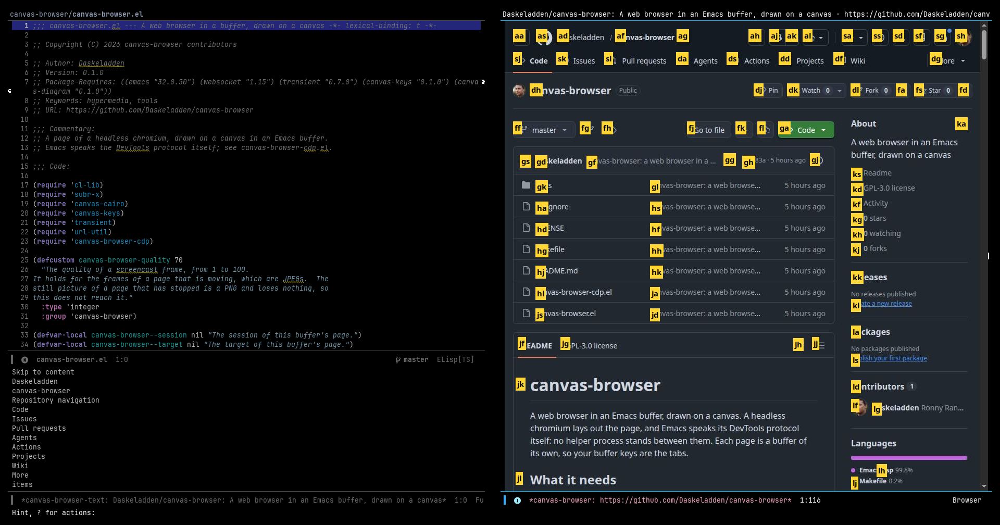

# canvas-browser

A web browser in an Emacs buffer, drawn on a canvas. A headless chromium
lays out the page, and Emacs speaks its DevTools protocol itself: no
helper process stands between them. Each page is a buffer of its own, so
your buffer keys are the tabs.



## Why

My Emacs runs on a remote machine, and I reach it over X. A link that I
open there must open there too: in a buffer, with the keys of Emacs, and
logged in to the sites I use. And I like to do as much as I can in
Emacs.

That includes the web applications of work, such as Outlook, Teams and
Confluence. They need JavaScript and a login, which eww cannot give
them, and here they are buffers.

## Other browsers in Emacs

eww draws the HTML as text in the buffer and runs no JavaScript. Use eww
where it is enough: `e` opens the same address there.

xwidget-webkit puts a WebKitGTK widget in the window. It needs an Emacs
that was built with xwidgets, which only the GTK build and the macOS
build can be.

EAF runs a Python process that draws the page with QtWebEngine in a Qt
window, and keeps that window over the Emacs window. The page is a
window of another program.

canvas-browser works in any build of Emacs 32 that has modules, and no
process stands between Emacs and chromium. The page is an image in the
buffer, which Emacs paints. So Emacs draws the hint labels on it, cuts a
part of it to copy a picture, and shows a page inside another buffer.

## What it needs

- Emacs 32 with canvas images and with modules.
- The `canvas-cairo` module. It is a part of
  [canvas-diagram](https://github.com/Daskeladden/canvas-diagram) and
  no package of its own. You compile it on your machine, against cairo
  and pango.
- [canvas-keys](https://github.com/Daskeladden/canvas-keys), the keys
  that every canvas buffer shares.
- The `websocket` package, and `transient` for the menu.
- Chromium. On Ubuntu that is `sudo snap install chromium`.
- `Xvfb`, the X server that chromium draws on, out of sight. On Ubuntu
  that is `sudo apt install xvfb`.

A snap writes only outside the hidden directories of your home, so the
profile of a snap chromium goes to
`~/snap/chromium/common/canvas-browser-profile`.
Another chromium keeps its profile under your cache directory. The
profile holds the cookies, so a site stays logged in between sessions.
A snap also has a `/tmp` of its own and reads no hidden directory of your
home, so a local page it cannot read, such as one another package wrote
to `/tmp`, is copied to `~/snap/chromium/common/canvas-browser-files`
before it opens. Only that file is copied.

## Install

No archive carries canvas-browser. Clone it and the two canvas packages
it needs, and build the module of canvas-diagram. The README of
canvas-diagram says what that build needs.

The build makes `canvas-cairo.so` in the directory of canvas-diagram.
Emacs loads the module from there. If Emacs cannot open the load file
`canvas-cairo`, the module is not built, or that directory is not on the
load path.

```sh
git clone https://github.com/Daskeladden/canvas-keys.git
git clone https://github.com/Daskeladden/canvas-diagram.git
git clone https://github.com/Daskeladden/canvas-browser.git
make -C canvas-diagram        # builds canvas-cairo.so
```

Install `websocket` from an archive, with `M-x package-install`. Then
put the three directories on the load path, here with the clones in
`~/src`:

```elisp
(dolist (name '("canvas-keys" "canvas-diagram" "canvas-browser"))
  (add-to-list 'load-path (expand-file-name name "~/src")))
(autoload 'canvas-browser "canvas-browser" "Open a URL in a page buffer." t)
(autoload 'canvas-browser-browse-url "canvas-browser")
```

## Use

`M-x canvas-browser` asks for a URL and opens it in a buffer. The page is
laid out for the window, and chromium sends a picture whenever the page
changes. The picture is a JPEG, painted on the canvas.

### As the browser of Emacs

To have every link Emacs opens open here, from any package, set:

```elisp
(setq browse-url-browser-function #'canvas-browser-browse-url)
```

Where no canvas can show a page, as in a terminal frame, the URL goes to
`canvas-browser-fallback-browser`, which is eww unless you set it.

### A page in another buffer

`canvas-browser-embed` opens a page whose picture shows inside another
buffer, such as a video in the description of an issue. It returns the
text to insert there. The page is drawn while a window shows that buffer.
A click on the picture reaches the page, and `RET` clicks its middle,
which starts or stops a video. The page goes when the buffer is killed,
or once the buffer no longer holds the text.

If the page goes fullscreen, as a video does from its fullscreen button,
the page fills a fullscreen frame of its own. When the page leaves
fullscreen, the frame goes and the picture is back in the buffer. If you
delete the frame, the page leaves fullscreen.

### Bookmarks

A page is an Emacs bookmark. `B` keeps the page as one, named by its
title unless you give another name, and `J` picks one of the pages you
kept and opens it. The names come as bookmarks, so marginalia, consult
and embark treat them as they treat any bookmark. `C-x r m`,
`bookmark-jump` and the bookmark list work with pages too. In
`consult-bookmark` the pages are in the Web group, next to those of
eww, so `w SPC` narrows to them. A bookmark of a page that a buffer
shows already goes to that buffer.

### Attaching a file

When you attach a file to a mail, the page asks for the file. A dired
buffer then opens in the other window, in the directory you last took a
file from. Mark the files there and press `C-c C-c`, or press it on one
file. `C-c C-k` tells the page that nothing was chosen. While a page
waits, the two keys are there in every dired buffer, so you can go to
another directory first. For a snap chromium, a file that the snap
cannot read is copied to `~/snap/chromium/common/canvas-browser-files`.

### Downloads

A downloaded file goes to `~/Downloads`, and the echo area names it when
it is complete. No dialog asks where to save it, also not for the
download button of a PDF. If the name is taken, the file gets a number,
as in `report (1).pdf`. Chromium writes the file into
`canvas-browser-downloads` in its profile first, and Emacs moves it from
there.

### What a page copies

A button of a page that copies, as "Copy link" does, puts its text on
the clipboard of chromium. That clipboard is on the hidden display. So canvas-browser reads it a moment after each
click, and text that is new there becomes the newest kill: `C-y` pastes
it. The echo area says what was copied.

A page can read the clipboard only with a permission. canvas-browser
gives the site that permission for the one read, and takes it back.
This works for a page that is served over https.

### A field in a buffer

`C-c '` opens the text of the field with the focus in an ordinary
buffer. Write there with all that Emacs has for text. `C-c C-c` types
the text into the field, in place of what the field holds. `C-c C-k`
leaves the field as it is. Neither key sends the text. It goes in as a
yank does, without a key, so a chat that sends on Enter sends nothing.

A field for a password does not open in a buffer.

An editor that a page builds itself, as the editor of a wiki or a chat
box, is a rich editor. There `C-c '` opens only the part that you
selected, as org, or an empty buffer when only the cursor is there.
`C-c C-c` puts the org in place of that part as formatted text, with
its headings, lists, bold text and links, and leaves the rest of the
editor alone. A selection that holds what org cannot hold, as a
picture, a table, a block of code or colored text, opens no buffer, so
nothing of it is lost. In a rich editor, `C-x u` is the undo of the
page.

When the edit ends, the buffer stays, and it is the buffer of that
field from then on. Its undo history is the history of the field, which
chromium keeps to itself. While you type in the page, the field is read
into the buffer at each pause, so each pause is one step there.

`C-x u` in the page buffer does with that history what the key does in
a buffer for text. With a package that shows the undo history on that
key, as undo-tree does, the view opens on the history of the field. A
step that you take there is typed into the field. Without such a
package the key is undo, and the page takes back a step, as on `C-/`.
A step back puts plain text in place of all that the field holds.

### Sending a page somewhere

`>` sends the page to a receiver, and asks which one. While the caret
marks text, it sends that text. With nothing marked, it sends the text
of the whole page. The text is all the text that the page shows there.
That includes what a web component draws of its own, which chromium
leaves out of its own text of a page. canvas-browser reads nothing into
the text: what is made of it is the business of the receiver. `t` shows the
same text.

To send one part of the page and not the rest, pick the part first
with `S`. `S` outlines and labels the parts that the window shows: the
main content, a sidebar, a header, an article, and every part that
scrolls on its own. A large pane of an application is a part too, with
or without content to scroll. Name the part you want. That part keeps
an outline
while it is picked, and the header line says `part`. `>` then sends
that part: it is tinted while you choose the receiver, and its whole
text goes, also what is out of the window. So the main content goes
without the sidebars and the footer. The part stays picked until you
pick another, or the page goes to another address. `C-g` goes back to the whole page, and so do `S` and the first
label. `S` and `ESC` change nothing.

Three receivers come with canvas-browser:

- `buffer` pastes the text into a buffer you name, at its cursor, as
  `C-y` does there. So it also works for the buffer of a terminal.
- `org capture` starts `org-capture` with a template you choose. In the
  template, `%i` is the text and `%a` is a link to the page. `%:link`
  and `%:description` are its address and its title.
- `org-roam node` asks for a node, one that exists or a new one with
  the title that you type. What is sent gets a heading of its own in
  that note, which links to the page. Under it stands a thread from a
  translator as an org list, and other text as a quote. The pictures
  of a thread are fetched from the page and kept among the attachments
  of the node, as org-attach keeps them. The list links to them where
  they stood. The heading names the directory of the attachments in
  its `DIR` property. org-attach does not look above a heading for the
  id of the note. Chromium gives a picture that it loaded, so a picture
  behind a sign-in comes too. A
  node that holds the thread already gets only what is new: a new
  message where it belongs, and a changed message as a new version
  under the old one, marked as edited. Your own text stays as it is.
  The templates are in `canvas-browser-org-roam-templates`, where `%i`
  is the text.

A receiver is a function with a name in `canvas-browser-receivers`. It
runs in the page buffer and gets one plist: `:kind` is `text`, `page`
or `part`, and `:text`, `:url` and `:title` are the text, the address
and the title. When a translator gave a thread, `:thread` holds it as
Lisp data, which the section Translators describes. A receiver that
wants more than the text calls
`(canvas-browser-content-html CONTENT)`, which gives the HTML of the
same thing as the page has it. The HTML still holds what lies inside
what, such as a reply inside the comment that it answers. What a web
component draws of its own is in a `template` inside the component. This adds a
receiver that copies the text:

```elisp
(add-to-list 'canvas-browser-receivers
             (cons "kill ring"
                   (lambda (content) (kill-new (plist-get content :text)))))
```

### Translators

canvas-browser knows no site. A translator is the one place that knows
one. It is a small snippet in your init file: a pattern for
the address of a page, and what makes text to read from the HTML of
that page. A page whose address has a translator is sent, and shown by
`t`, as the text that the translator makes. If the translator finds
nothing to translate in what is sent, the text goes as the page shows
it.

Most pages worth a translator are threads: a post, and comments with
replies under them. For those, a translator only says which elements
are the items, and where each keeps its title, its author, its time and
its text. This one is for the comment pages of Reddit:

```elisp
(canvas-browser-add-translator
 "reddit\\.com/r/[^/]+/comments/"
 (canvas-browser-thread-translator
  '(shreddit-post :title (attr post-title) :author (attr author)
                  :time (attr created-timestamp)
                  :body (inside slot "text-body"))
  '(shreddit-comment :author (attr author) :time (attr created)
                     :body (inside slot "comment"))))
```

The text then names each item with its author and its time. A reply
stands two spaces further in than the comment that it answers:

```
alice · 2026-10-01 20:15

How well does it work?

  bob · 2026-10-01 20:26

  For me it works well so far.
```

In the text, a picture stands as its description in brackets, such as
`[image]`, and an emoji as itself. The brackets carry the address of
the picture, so a receiver can fetch it with
`canvas-browser-picture-bytes`.

A thread translator also gives the thread as Lisp data: a list of
items, each a plist with `:title`, `:author`, `:time`, `:text` and
`:replies`. A receiver gets it as `:thread`, next to the text. The org
capture and org-roam receivers use it: in the note, the thread is an
org list. The author is in bold, and a reply is an item inside the item
it answers. An empty line stands between two items, and each time is an
org timestamp. `canvas-browser-thread-text` and
`canvas-browser-thread-org` write a thread out as text and as an org
list.

An item can have an address of its own, as a message of a chat has. Add
`:link` to the item of the translator, with a way to read the address,
and the item has it as `:link`. In the org list, the head of such an
item ends with a link to it. The text to read names no address.

An item is named by its tag, as `shreddit-comment` above, or by an
attribute as `(data-role "comment")`. Inside an item:

- `(attr NAME)` is an attribute of the item.
- `(inside ATTRIBUTE VALUE)` is the first element inside it whose
  attribute has that value.
- `(matching ATTRIBUTE REGEXP)` is the first element inside it whose
  attribute matches the regexp, as `(matching id "\\`content-")`.
- `(tag NAME)` is the first element inside it with that tag.
- `(inside ATTRIBUTE VALUE READ)`, `(matching ATTRIBUTE REGEXP READ)`
  and `(tag NAME READ)` give the
  attribute READ of that element, as `(tag time datetime)` gives the
  time of a `time` element.
- A function of the element can do the rest.

An item that holds no title, no author and no text is dropped. So an
element that a page marks like an item, such as the frame of a picture,
does no harm.

A page that is no thread takes any function as its translator. That
function gets the parsed HTML, which `dom.el` reads, and returns the
text. The helpers `canvas-browser-dom-text` and
`canvas-browser-dom-with` are there for it. Translators need an Emacs
with libxml.

### The index of a page

`imenu` works in a page buffer, and so does `consult-imenu`. The index
is the outline of the page: its headings, each with the headings under
it. Pick one, and the page scrolls to it and paints it for a moment.
With consult, the page shows each entry while you move to it. `C-g`
puts the page back where it was.

At an address with a thread translator, the index also has a menu
`Messages`. It lists each message by its author and the start of its
text, with a reply under the message that it answers. Pick one, and
the page shows where its text stands.

### A search of every page

`M-x canvas-browser-search-pages` searches the text of every page that
is open. The lines stand under the titles of their pages, and you
choose one as with `consult-line`. With consult, the window shows the
page of each line while you move to it, at that line. If you choose
none, the window shows what it showed before. `M-s M-p` runs this
command in a page buffer, and so does the key of `consult-line-multi`.
The menu has it too.

### The links of a page

`a` offers the links that the page shows, each by its text and its
address, so you can choose by either. With consult, the page shows each
link while you move to it. If you choose none, the page goes back to
its place. The link that you choose is clicked, as a hint clicks it.
`C-u a` opens its address in a page buffer of its own.

### Org links

`org-store-link` in a page buffer keeps a link to the page, named by
its title, and `org-capture` there has the page in `%a`. `C-c C-l` runs
`org-store-link` in a page buffer, and the menu has it. With text
marked, by the caret or with the mouse, the address of the link names
the text. A browser that opens such an address scrolls to the text. The
marked text is also the `%i` of a capture. The same works in the buffer
that `t` fills, with the region as the text.

### Marks and registers

A page buffer has a mark ring of its own, for where the page stands.
`C-SPC` sets the mark. A mark keeps how far the page and each part of
it are scrolled. `C-u C-SPC` goes back to the newest mark, and the next
time to the mark before it. `C-x C-x` swaps the mark and the place of
the page. A jump sets the mark too: to the top or the end of the page,
to an entry of the index, to the hit of a search.

`C-x r SPC` keeps the place of the page in a register, and `C-x r j`
comes back to it from any buffer. If no buffer shows the page any more,
the page opens again. A page that loaded again knows how far it was
scrolled as a whole, but not how far each part was.

### History

`H` offers the pages that you visited, the newest first, each by its
title and its address. The page that you choose opens in this buffer.
`C-u H` opens it in a page buffer of its own, and so does
`M-x canvas-browser-history` in any other buffer. The key of
`consult-history` asks for this history too in a page buffer. The
history is kept in the file that `canvas-browser-history-file` names.
`M-p` in the prompt of `o` and `O` steps through the same pages, without
the page that the buffer shows. The list below that prompt shows them
too, with the page that the buffer shows among them.

### Embark

`embark-act` in a page buffer acts on the page. It has the actions of
any URL, so you can open the address in another browser or in eww, copy
it, or download it. `>` sends the page to a receiver. When a part of
the page is picked with `S`, that part is a target before the page, and
`>` sends the part. While the caret marks text, the text is the first
target. `embark-cycle` reaches the targets after the first. On marked
text, `s` searches for it in a page buffer of its own, and `>` sends it
to a receiver.

A link that `a` offers is a URL for `embark-act`, which has the actions
of any URL for it in the minibuffer.

### Notifications

When something comes in, a page such as a mail page shows a
notification. Chromium shows it in a window of its own, on a display
that nobody sees. So canvas-browser hands the notification to Emacs.

A site shows notifications only after you allow it. Open a page of the
site and run `M-x canvas-browser-notifications`. The command asks, and
keeps the answer in `canvas-browser-notification-sites`. Run it again
to change the answer. The menu of the page has a switch for the same,
`SPC N`. It reads `notify on` or `notify off` for the site of the page.
When a page wants to show notifications, chromium asks the same question
in its own window. Nobody sees that question, so the page waits until
you run the command or use the switch.

Each notification goes to the functions of
`canvas-browser-notification-functions`. A function gets one plist.
`:title` and `:body` are the text, and `:source` names where it comes
from, as `example.org`. `:origin` is the site, `:url` and `:page-title`
are the address and the title of the page, and `:buffer` is the page
buffer.
`(canvas-browser-notification-open NOTIFICATION)` shows that page and
tells it that the notification was clicked. A mail page then opens the
mail. A site can close its notification after a moment, as a chat site
does. You can open the notification after that too. If the page was
loaded again since, it has the notification no more. Then you see the
page, and the echo area says so. If the page buffer is gone, a page of
the site opens. As the package comes, one function says the notification in the
echo area. This adds a desktop notification through D-Bus, with a click
that opens the page:

```elisp
(require 'notifications)
(add-hook 'canvas-browser-notification-functions
          (lambda (notification)
            (notifications-notify
             :title (plist-get notification :title)
             :body (plist-get notification :body)
             :actions '("default" "Open")
             :on-action (lambda (&rest _)
                          (canvas-browser-notification-open notification)))))
```

canvas-browser puts nothing into the pages of a site that you did not
allow. A site that you allowed gets a `Notification` that tells Emacs,
in place of the one of chromium.

A site often has a setting of its own for desktop notifications. That
setting must be on as well.

A service worker is a script of a site that runs in the background. A
mail site lets it show the notifications of new mail, which reach it by
web push. No script in a page sees those. Chromium hands them to the
notification service of the desktop, over D-Bus. If no other program is
that service, canvas-browser can be it: set
`canvas-browser-notification-service`. Those notifications then go to
the same functions. Chromium looks for the service at its start, so run
`M-x canvas-browser-restart-chromium` after you set the option.

Emacs is then the notification service for every program of your
session, not for chromium alone. A desktop with a notification service
of its own keeps it, and shows the notifications itself.

A service worker needs no page of its site, only a chromium that runs.
canvas-browser starts chromium with the first page that you open, and
keeps it after the last page buffer is gone. So the notifications of
new mail come also while no page of the mail site is open. Such a
notification has a page buffer only while a page of its site is open.
To open it shows that page. If no page is open, the site can open one
itself, as a mail site opens the mail. That page gets a page buffer. If
the site opens none in two seconds, canvas-browser opens the site.
Chromium does not always hand the click on to the service worker.

### Blocking ads

`M-x canvas-browser-install-ublock` downloads the newest uBlock Origin
Lite from its releases on GitHub and installs it for canvas-browser. Run
it again to update. It blocks ads and trackers with the lists of uBlock
Origin, and it swaps a blocked ad script for a harmless stand-in, so a
page that waits for the script still works. It needs `unzip`.

Chromium loads extensions only when it starts. If chromium runs, the
command offers a restart, and `M-x canvas-browser-restart-chromium` does
the same at any time. The restart opens again every page that a window
shows, and the other pages open again when they are next shown.

Every directory with a `manifest.json` in
`canvas-browser-extension-directory` is an unpacked extension, which
chromium loads. By default that is
`~/snap/chromium/common/canvas-browser-extensions` for a snap chromium,
which can read no hidden directory of your home, and
`~/.local/share/canvas-browser/extensions` for another chromium.

## The keys

Normal state keeps the keys of Emacs:

| key | what it does |
|---|---|
| `o` | opens a URL in this buffer, or searches for the words you type. One word with no dot, slash or colon is searched for too. `espresso/` or a scheme such as `http://espresso` reaches a host of that name. The pages that you visited and that match what you type show in the list of a completion view such as vertico. `RET` opens what you typed. Move to a line of the list, and `RET` opens that page. Without such a view, `TAB` completes what you type to the title and address of a visited page. In the prompt, `M-p` steps back through the pages that you visited, and `M-n` steps forward again. A first `M-n` brings the address of the page |
| `B`, `J` | keep this page as a bookmark, and open a page you kept |
| `H` | offers the pages that you visited, the newest first, and opens the one you choose |
| `C-SPC`, `C-u C-SPC`, `C-x C-x` | set a mark where the page stands, go back to the newest mark, and swap the two |
| `C-x r SPC`, `C-x r j` | keep the place of the page in a register, and come back to it from any buffer |
| `y` | copies the address of this page, as `f y` copies the address of a link |
| `>` | sends the marked text to a receiver you name, or else the part picked with `S`, or else the text of the page |
| `O` | the same as `o` in a page buffer of its own, as the `O` of Vimium and qutebrowser opens a tab |
| `g` | reads the page again |
| `M-p`, `M-n` | go back and forward in the history |
| `n`, `p` | scroll a line further down and back |
| `C-v`, `M-v`, the arrows | scroll a screen and a line |
| `<prior>`, `<next>` | scroll a screen back and further down |
| `<home>`, `<end>`, `C-<home>`, `C-<end>`, `M-<`, `M->` | go to the top and the foot of the page |
| `f` | labels what a click can reach, fields inside web components included, and clicks the one you name; the labels stay until you name one or press `ESC` |
| `a` | offers the links of the page by their text and address, and clicks the one you choose. `C-u a` opens it in a page buffer of its own |
| `M-w` | labels the page and its blocks, and copies the picture of the one you name. `C-u M-w` copies the whole window at once |
| `C-c C-l` | stores a link to the page for org, also while the keys go to the page |
| `S` | outlines and labels the parts of the page, and picks the one you name: `>` sends its text, and the scroll keys move a part that scrolls on its own |
| `v` | moves a caret through the text of the page with the motions of Emacs |
| `M-j` | puts the caret on text you type, as `avy-goto-char-timer` puts point |
| `TAB`, `S-TAB` | go to the next and the previous field, and type there |
| `C-s` | searches the page while you type, as isearch does. `C-s` and `C-r` step to the next hit and the one before. `M-r` switches to a regexp of JavaScript. `RET` stays at the hit, and `C-g` goes back to where the page was |
| `C-r` | steps to the hit before, in the last search |
| `d` | turns dark mode on or off, for this page and the next ones |
| `i` | sends the keys to the page, as a click in a field does |
| `C-c '` | opens the text of the field with the focus in an ordinary buffer, also while the keys go to the page |
| `C-/`, `C-?` | undo and do again in the field of the page. A page buffer has no text of its own to undo |
| `C-x u` | shows the history of the field, with a package that shows the undo history on that key. Without one, it is undo |
| `t` | puts the text of the page, or of the part picked with `S`, in an ordinary buffer |
| `M-s M-l` | searches that text with `consult-line`, also while the keys go to the page |
| `M-s M-p` | searches the text of every page that is open, and shows the page at the line you choose |
| `M-.` in that text | shows the page at the line: the page scrolls to it and paints it for a moment, and `M-,` comes back to the text |
| `e` | opens the same URL in eww |
| a click | clicks the page at that pixel, and types there if it is a field |
| a click on the address in the header line | opens the prompt of `o` with the address in it, ready to edit. The address lights up under the pointer |
| a drag | marks what lies between its two ends, once the button is let go |
| the wheel | scrolls what lies under the pointer, over a link as well |
| the wheel with shift | scrolls it sideways |
| the wheel with control | zooms the page a step, as `+` and `-` do |

With smear-cursor on, you see where a search lands: the first hit is
flashed, and the cursor of smear-cursor flies from one hit to the next.

The scroll keys move the page itself, which happens at once. The wheel
goes to the page as a wheel, at the pixel the pointer is over, so that it
scrolls the part of the page that lies there, as it does in any browser.

The wheel is a gesture of canvas-keys.
So it reaches the page also while a minor mode such as `pixel-scroll-precision-mode` binds the wheel.
One notch moves the page by `canvas-keys-wheel-step` pixels.
The page keeps the buttons: canvas-keys binds no drag here, and the middle click yanks while you type.
A click, a drag and the middle click go to the page under the pointer, and they select its window.

A page is often more than one thing that scrolls: a list beside the text,
a pane of its own. `S` labels every such part with the letters of the
hints and hands the scroll keys to the one you name, the way `ace-window`
hands the keys to the window you name. The whole page carries the first
letter itself, in the top corner, so the keys go back to it by a letter
as well as by `ESC`; so does a part that the page has thrown away, which
it says when it happens.

The menu shows how the settings stand, with a star for a value that a
fresh Emacs would not have, and `C-x C-s` in the menu keeps the starred
ones through Customize.

The common canvas keys come from canvas-keys: `SPC` opens the menu,
`q` buries the buffer, `m` shows and hides the map, `W` writes the
picture, `M-w` copies it, `C` opens Customize, and `+`, `-` and `0` zoom
the page. The pointer becomes
a hand over anything that can be clicked.

Insert state sends every key to the page, so that you can type in a
form. A click in a box you can type in enters it by itself, and a click
anywhere else leaves it, so a form works as it does in any browser.
`ESC` comes back to normal state, and `C-g` as well, since another
package may have taken `ESC`. The header line says `insert` while it
lasts. A field inside a web component, as on the login page of Reddit,
counts as a field: the focus is followed into the component.

A hint goes only where a click in the middle of what shows of a thing
reaches it, or reaches its label. Whatever lies outside the window,
under a dialog, or around something else that can be clicked, as a link
around a button does, gets none. On the front page of Reddit that took
the hints from 388 to 35, and with the login dialog open the page under
it gets none at all. A click is followed up through the slot a web
component puts its text in, so a link built that way, as Reddit's
"Continue with Phone Number" is, counts.

A role counts only where it says the thing does something, as Vimium has
it: an icon or a heading marked as only looking takes no hint, and
inside a button it would crowd the button. Nor does a thing of a few
pixels, as a tracker is. A frame the size of a button counts, since a
click in it reaches what it holds, as Google's button to sign in is,
and a taller one is an advertisement and does not. On the page of a
subreddit that took 9 of 69 labels away, among them the five crowded
onto the bar that sorts the posts. Past the hints of two letters come
hints of three, so no box is left without one.

A region the page shows the pointer over counts too, since a script
that listens for clicks marks one so: the outermost element of it,
unless it fills half the window. A picture in a post of Reddit opens
this way, and so does a heading that opens a list. And a thing covered
by another thing that can be clicked gives its place to that one: the
link over a post of Reddit covers its title, and takes its hint there.
Finding the regions costs about 7 ms on the front page of Reddit, whose
web components hold 13,538 elements, because the search stops inside
anything that already counts.

A label goes at the top left corner of its box. When two would meet
there, as a post of Reddit that is a link meets the link of its author,
the small box keeps the corner and the label of the large one goes in
its middle, where a click on it lands anyway.

A key pressed before the letters of a hint picks what the hint does, as
the dispatch keys of avy do, and the prompt names it:

| key | the hint then |
|---|---|
| none | clicks it, or with `M-w` copies its picture |
| `y` | copies its address |
| `w` | copies its text |
| `c` | copies its picture, as much of it as shows |
| `o` | opens its address in a page buffer of its own |
| `e` | opens its address in eww |

`?` before the letters lists these keys in the prompt, as it does in
avy.

`f` labels what can be clicked, and `M-w` labels the blocks of the page:
a header, a sidebar, an article, a dialog, a table, a piece of code, a
picture. So `f y` and a hint copies the address of a link, and `M-w w`
and a hint copies the text of an article. None of these keys is a letter
of the hints, and the code refuses one that is.

`M-w` labels the whole page too, with the first letter, in the top
corner. That label copies the picture of the page as the window shows
it. `M-w w` and that label copies the text of the whole page, and
`M-w y` its address.

When a click or a tab moves the focus of the page, smear-cursor flies
its cursor from the box that had the focus to the box that has it, as it
flies when point moves in text: from the name to the password of a form,
say. `canvas-browser-focus-function` names what flies, and nil turns it
off; without smear-cursor nothing flies.

Whatever a hint copies pulses: smear-cursor plays its copy effect over
the box of the address, the text or the picture, as it does over text
copied anywhere in Emacs. `canvas-browser-pulse-function` names what
pulses, and nil turns it off; without smear-cursor nothing pulses.

A picture is cut in Emacs, with cairo, from a picture of the whole
window, as much of the block as shows, and goes to the clipboard through
kill-ring-images. Chromium can cut a part itself, but it does so by
moving the view of the page to the part, and the view stays moved for a
while after: every frame and every picture of that while shows the page
shifted into a corner, or a part of it repeated across the window.

The editing keys of Emacs edit the field, as the Emacs key theme of GTK
and the insert mode of Surfingkeys have them do:

| key | in the field |
|---|---|
| `C-a`, `C-e` | the start and the end of the line |
| `C-f`, `C-b`, `C-n`, `C-p` | a character right and left, a line down and up |
| `M-f`, `M-b`, `C-<right>`, `C-<left>` | a word right and left |
| `C-<up>`, `C-<down>`, `M-{`, `M-}` | a paragraph up and down |
| `C-v`, `M-v` | a page down and up |
| Shift with an arrow, `<home>` or `<end>` | mark while you move, as in a browser |
| `M-<`, `M->` | the start and the end of the field |
| `DEL`, `C-d` | delete the character before and after the cursor |
| `M-DEL`, `M-d`, `C-<backspace>`, `C-<delete>` | delete the word before and after the cursor |
| `C-k` | kill to the end of the line, and at its end the line break |
| `C-y`, `S-<insert>`, the middle button | type the newest kill of Emacs |
| `C-/`, `C-?` | undo, and do again |
| `C-x u` | the history of the field, or undo |
| `S-<return>` | a line break where Enter alone sends, as in a chat |
| `C-<return>` | Control and Enter, which send many a form |
| `TAB`, `S-TAB` | the next and the previous field |
| `C-SPC` | set the mark: the motions after it mark a region of the field |
| `C-x h` | mark all of the field |
| `M-w`, `C-w` | copy the region, and cut it |
| `C-g` | drop the mark, and then give the keys back to Emacs |

A form is filled from the keyboard: `f` and the hint of the first field,
the text, `TAB`, the next text, and `RET`. `TAB` goes from field to
field only, as the `gi` of Vimium does, because a page puts buttons
between its fields: Reddit puts the one that shows the password between
the name and the password, and a tab of the browser's own stops there.
The first and the last field follow one another. A button is reached
with `f`.

A letter goes to the page as a key that types, so it reaches whatever
has the focus, as a key pressed in a browser does. Text put in without a
key lands at the caret instead, and the caret stays behind in a field
that the focus has left.

A key reaches chromium with the number Windows gives it as well as its
name, because chromium edits a field by that number: sent by its name
alone, backspace arrives as an event that deletes nothing.

The search paints every hit in the page itself, with the highlight API of
CSS, and scrolls to the one you are on. `window.find` answers in a
headless chromium but leaves nothing to see.

The buffer that `t` fills is an ordinary buffer, so isearch,
`consult-line` and the kill ring work on the text of the page.

## The caret of the page

A drag of the mouse over the text of a page marks it and copies
nothing, as a drag in a buffer does. The caret then has the keys, with
the text as its region: `M-w` copies it, and `C-g` drops the mark. If
you set `mouse-drag-copy-region`, the drag copies here as well. In a
field the keys stay with the field, and its own `M-w` copies the mark.

`v` gives the page a caret, a point that the motions of Emacs move
through its text: `C-f` and `C-b` a character, `M-f` and `M-b` a word,
`C-n` and `C-p` a line, `C-a` and `C-e` to the ends of the line, `M-<`
and `M->` to the ends of the page, and the arrows as well. `C-SPC` sets
the mark and the motions then mark a region, which chromium draws as it
draws any selection; `M-w` copies it and pulses it. `C-g` drops the mark,
and then leaves the caret, as `ESC` and `v` do.

The caret starts after what has the focus, so that from a field you go
on reading where you were: `C-g` gives the keys back, and `v` starts
there. With nothing focused it starts at the first text in view, as the
caret mode of Vimium does. The page scrolls to keep the caret in view,
and smear-cursor flies from each place it stands to the next.

The caret is the selection of the page, moved as the Selection API of
the browser moves it, a character, a word or a line at a time. A page
that takes no typing draws no caret of its own, so a bar stands where it
is: the colour of the cursor of Emacs, with an edge of black or white,
whichever stands out, since a white bar alone vanishes on a white page.

## Jumping to text

`M-j` puts the caret on text you type, as `avy-goto-char-timer` puts
point. The key that runs `avy-goto-char-timer` does the same in a page,
even when `bind-key*` binds it. You type until you pause for `avy-timeout-seconds`, or for 0.5
seconds without avy. `RET` ends the text at once, `DEL` takes a
character back, and `ESC` gives up. Every place in view that shows the
text then takes a label, drawn and named as the labels of `f` are.
Naming a label puts the caret there, and smear-cursor flies to it.

A single place takes no label, as `avy-single-candidate-jump` has it.
Text in lower case matches either case, and text with a capital matches
only itself, as in avy. With the mark set, the region reaches to the
place instead, so `C-SPC` and a second `M-j` mark from one word to
another. From normal state, `M-j` also starts the caret.

A place counts only where its text shows. Invisible text takes no
label, and neither does text that a clipping box cuts off, such as a
heading kept for screen readers only. Text under something that paints,
such as the veil of a dialog or a banner, takes no label either. A clear
link that a page lays over a card paints nothing, so the title of a
Reddit post under it takes a label. Text that runs across two elements,
into a bold word for example, is not found, and neither is text inside a
frame.

## The name of a page buffer

A page buffer is named after the address it shows, and takes the new
one whenever the page moves, by a link, by `o` or by the page itself, so
that `C-x b` says what each buffer holds. The header line shows the
title the page gives itself once it has loaded: until then chromium
names a page after its file. A page embedded in another buffer keeps the
name its host gave it, since the host finds it by that name.

## Windows a page opens

A window a page opens gets a page buffer of its own, shown beside the
page that opened it, as a browser shows a new window: the buttons to
sign in with Google or with Apple open one, and so does a link that
opens a tab. When such a window closes itself, as the one to sign in
does once you have, its buffer goes with it. Chromium tells of every
page that opens and closes; only a page that one of these buffers
opened is taken, and a frame or a worker is left alone.

A tab that chromium opens on its own at a web address gets a page
buffer too. When you open the notification of a mail site, its service
worker opens such a tab. A tab without a buffer stands in front in
chromium, where nobody sees it. Its site then takes it that you look at
the page, and shows no more notifications.

## The map of canvas-minimap

No map opens beside a page: canvas-browser puts `canvas-browser-mode`
in `canvas-minimap-exclude-modes`. A page is a picture, not lines of
text, and a map of it told the reader nothing the window does not. Take
the mode out of that list to have the strip back, as an empty block.

## While it moves, and once it stops

A page that is moving is painted from the JPEG frames of chromium's
screencast, which are cheap to make and show their workings around
small text. `canvas-browser-crisp-delay` after the last key or click the
window is asked for a still picture as a PNG, which loses nothing, and
that is what you read. Remote desktops do the same thing under the name
of a lossless refresh.

The keys decide the moment, not the frames. A page with a spinner on it
never falls quiet, and waiting for quiet would leave it lossy for as long
as you looked at it; waiting on the keys instead means the page is crisp
about four tenths of a second after you stop scrolling, measured at 0.39
and 0.43 seconds on a GitHub Actions page. A still picture costs chromium
a fifth of a second, so none is taken while you are working the keys, one
asked for before a key and arriving after it is dropped as a picture of
the page as it was, and no more than one is taken every
`canvas-browser-live-interval`.

A page is seldom either moving or still: a spinner beside a running job
turns while the text around it stands. Every still picture is therefore
followed by a question to the page about what is moving on it, which it
answers from `document.getAnimations()` and from its videos, canvases
and GIFs. While those parts cover less than `canvas-browser-live-share`
of the window, each frame is drawn into them alone and the rest of the
canvas keeps the still picture, with a fresh still every
`canvas-browser-live-interval`. Measured on a GitHub Actions page with
five spinners: 77 frames in 8.3 seconds, every one of them drawn into
the spinners alone, and four still pictures in between.

The page may of course change outside those parts, and that change waits
for the next still picture. Any command in the buffer forgets the moving
parts at once, so a scroll, a click or a key draws the whole window
again.

Chromium sends a screencast frame after every picture it is asked for,
the picture being a draw like any other. Painted, that frame would ask
for the next still picture, and the two would take turns on the canvas
for ever, which the reader sees as a pulse around small text. A frame
that is the picture the canvas already holds is therefore dropped, which
is told by the md5 of its bytes.

The numbers of one window of 1874 by 921 pixels: a JPEG at quality 70 is
120 kB and takes 0.10 s, the same picture at quality 95 is 235 kB, and
the PNG is 228 kB and takes 0.22 s. The PNG is therefore too slow for
twelve frames a second and cheap for a page standing still. Drawing a
frame into the moving parts costs about three milliseconds, and drawing
the whole window about four, so the parts are clipped in one path and the
picture read once: read once for each of five parts, the same frame cost
sixteen milliseconds.

## A window of its own

Chromium runs with a window, on an X display of its own: `Xvfb` is
started on `canvas-browser-display` (`:98` by default) the first time a
page is opened, and nothing is ever shown there. The page is read
through the screencast, so none of it travels to your own display, which
matters when that display is forwarded over ssh.

This is about what the sites see. A headless chromium says
`HeadlessChrome` in its user agent, keeps `navigator.webdriver` true and
has no WebGL at all, and a site behind a bot check reads all three: it
then asks you to pick out traffic lights rather than to tick a box. With
a window, and with WebGL drawn in software, the same four questions
answer as they do in any Chrome.

It is also faster. On the same page, the time from a scroll key to the
new picture is 5 ms with a window and 26 ms without it, a still picture
costs 0.18 s against 0.22 s, and the memory is the same to within half a
percent, plus 87 MB for `Xvfb`. Software WebGL is for WebGL alone:
drawing the whole window that way, which `--use-angle=swiftshader` does,
cost two whole cores.

Set `canvas-browser-headless` on a machine with no X server to give
chromium a window on.

## Settings

| setting | default | what it is |
|---|---|---|
| `canvas-browser-chromium` | chromium, chromium-browser, google-chrome | the names looked for |
| `canvas-browser-profile-directory` | by the chromium found | where the profile goes |
| `canvas-browser-download-directory` | `~/Downloads/` | where a downloaded file is saved |
| `canvas-browser-cdp-timeout` | 10 | seconds to wait for chromium |
| `canvas-browser-headless` | nil | whether chromium runs without a window of its own |
| `canvas-browser-display` | :98 | the X display chromium draws its window on |
| `canvas-browser-quality` | 70 | the quality of a moving frame, from 1 to 100 |
| `canvas-browser-crisp-delay` | 0.4 | seconds of quiet before the page is drawn again without loss |
| `canvas-browser-pulse-function` | smear-cursor's copy effect | what draws the eye to what a hint copied, or nil |
| `canvas-browser-focus-function` | smear-cursor's flight | what draws the eye from the old focus to the new, or nil |
| `canvas-browser-live-interval` | 2.0 | seconds between two still pictures while a part keeps moving |
| `canvas-browser-live-share` | 0.3 | how much of the window may move and still count as parts of it |
| `canvas-browser-live-pad` | 4 | pixels a moving part grows by |
| `canvas-browser-frame-interval` | 0.08 | the shortest time between two drawings of the page |
| `canvas-browser-hidden-interval` | 2.0 | the same for a page no window shows |
| `canvas-browser-fresh-interval` | 2.0 | seconds between two looks at whether the window is fresh |
| `canvas-browser-second-try` | 0.5 | seconds before a window still empty is asked again |
| `canvas-browser-hint-keys` | asdfghjkl | the letters a hint is made of |
| `canvas-browser-hint-font` | Sans Bold 11 | the font a hint is written in |
| `canvas-browser-zoom-step` | 1.2 | what one zoom key, or one notch of the wheel with control, changes |
| `canvas-browser-line-height` | 40 | pixels that `n` and `p` scroll |
| `canvas-browser-search-url` | DuckDuckGo | where words are searched for |
| `canvas-browser-spots-delay` | 0.3 | seconds of quiet before the pointer areas are read |
| `canvas-browser-history-length` | 1000 | how many visited pages the history keeps, or nil for none |
| `canvas-browser-history-file` | under `~/.local/share` | the file that keeps the history between sessions, or nil |
| `canvas-browser-field-history-delay` | 1 | seconds of quiet before the field is read into its buffer, or nil to keep no history of what is typed in a page |

A page that stops answering for a few seconds says so in the echo area,
and `g` reads it again.

A window that has just changed size is filled as soon as chromium has
laid the page out for it, and a window that paints nothing for
`canvas-browser-fresh-interval` seconds asks for a picture of itself, so
a window left black by a missed frame fills itself again.

A page that no window shows is left to chromium, which throttles it as
it throttles any tab behind another: its frames are stopped until you
come back to it, and a handful of news sites no longer fight for the
machine.

## What it does not do

- Video and animation: a frame reaches the screen after what you do, and
  a full frame costs about 3.5 MB on a display without shared memory.
- Tabs of its own, printing and developer tools.
- A second engine.

## The tests

`make test` runs against a stubbed websocket and needs no chromium.
`make gui` sends real turns of the wheel to a page buffer on a virtual display, and it needs no chromium either.
It needs `xvfb-run`, `python3` and the libraries `libX11` and `libXtst`.
`make live` opens `tests/fixtures/page.html` in a real chromium, waits
for a picture, and reads the text of the page.
